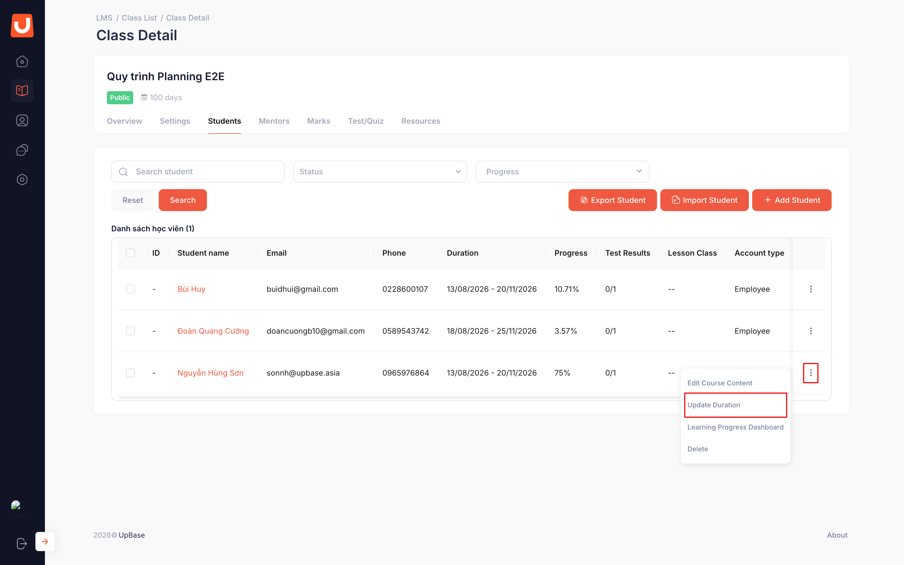

# Quản lý học viên trong lớp

## I. Thông tin chung


#### Phạm vi & Module liên quan

* **Module chính:** Class
* **Module liên quan:** Student


## II. Hướng dẫn chi tiết

Thêm học viên vào lớp



**Chọn Tab Students** → **Add Students**

<figure><figcaption></figcaption></figure>



**Chọn học viên cần thêm vào lớp → Add**

<figure><figcaption></figcaption></figure>



Import học viên vào lớp



**Chọn Tab Students** → **Import Student**

<figure><figcaption></figcaption></figure>



**Chọn file danh sách học viên cần Import vào lớp → Import**

<figure><figcaption></figcaption></figure>


Nên tải **file mẫu** trước khi nhập dữ liệu import; dữ liệu cần tuân thủ đúng cấu trúc và định dạng của template.




**Xem kết quả Import**

Hộp thoại kết quả import hiển thị sau khi xử lý file:

* Tên file
* Tổng số bản ghi
* Số học viên thêm thành công và số học viên thêm thất bại



**Xem View Log**

Chọn **View Log** tại hộp thoại kết quả import để xem chi tiết trạng thái từng bản ghi.



Xóa học viên khỏi lớp

**Xóa một học viên**

<figure><figcaption></figcaption></figure>

**Xóa nhiều học viên**

<figure><figcaption></figcaption></figure>

Chỉnh sửa thời hạn truy cập cho từng học viên



**Class Detail → Student → Action → Update Duration**

<figure><figcaption></figcaption></figure>



**Cập nhật thời hạn mới → Save**

<figure><figcaption></figcaption></figure>



Điều chỉnh cấu phần học theo từng học viên



**Class Detail → Student → Action → Edit Course Content**

<figure><figcaption></figcaption></figure>



**Điều chỉnh cấu phần → Save**

<figure><figcaption></figcaption></figure>

**Quy tắc chọn/ bỏ chọn cấu phần học của học viên**

<table data-search="false"><thead><tr><th>Thao tác</th><th>Quy tắc</th></tr></thead><tbody><tr><td><strong>Chọn/ Bỏ chọn All</strong></td><td>Tất cả checkbox cấu phần học được tick hoặc bỏ tick.</td></tr><tr><td><strong>Chọn Section</strong></td><td>Tất cả Activity, Test, Quiz thuộc Section được chọn.</td></tr><tr><td><strong>Chọn Activity</strong></td><td>Section chứa Activity đó được chọn.</td></tr><tr><td><strong>Bỏ chọn cấu phần học</strong></td><td>Cấu phần bị bỏ chọn sẽ không xuất hiện trong chương trình học của học viên và học viên không cần học cấu phần đó.</td></tr><tr><td><strong>Xóa cấu phần đã học</strong></td><td>Không được phép xóa khỏi chương trình học của học viên.</td></tr><tr><td><strong>Xóa cấu phần chưa học</strong></td><td>Được phép xóa khỏi chương trình học của học viên.</td></tr></tbody></table>



Cho học viên hoàn thành khóa Foundation

**Tại lớp Lesson có gắn Foundation → Student → Action → Allow Pass Foundation**

<figure><figcaption></figcaption></figure>


Sau khi Allow Pass Foundation, học viên không bắt buộc phải hoàn thành khóa học nền tảng và có thể bắt đầu học luôn khóa học chính.


## III. Lưu ý & Quy tắc nghiệp vụ


### Lưu ý quan trọng

1. Khi thêm/ xóa học viên khỏi lớp **Type = Lesson**, học viên đó cũng được thêm/ xóa ở lớp **Foundation** gắn với lớp ban đầu.
2. Với lớp có **Duration = Flexible**, nếu học viên chưa kích hoạt khóa học thì không thể cập nhật thời hạn học của học viên đó.
3. Thời hạn học riêng của học viên có thể dài hơn hoặc ngắn hơn thời hạn mặc định của lớp.
4. Chỉnh sửa cấu phần học của từng học viên chỉ áp dụng cho học viên được chọn, không ảnh hưởng đến toàn bộ lớp.
5. Chỉ được xóa cấu phần học khỏi chương trình của học viên nếu học viên chưa học cấu phần đó; nếu đã học thì hệ thống không cho phép xóa.
6. Chức năng **Allow Pass Foundation** chỉ áp dụng khi lớp Lesson có gắn lớp Foundation và học viên cần được đánh dấu hoàn thành Foundation để học khóa chính.


## IV. Các lỗi thường gặp & Hướng dẫn xử lý

| Lỗi / Tình huống                           | Nguyên nhân                                                 | Cách xử lý                                            |
| ------------------------------------------ | ----------------------------------------------------------- | ----------------------------------------------------- |
| Không cập nhật được thời hạn học           | Lớp Duration = Flexible và học viên chưa kích hoạt khóa học | Chờ học viên kích hoạt khóa học rồi cập nhật thời hạn |
| Không xóa được cấu phần học của học viên   | Học viên đã học cấu phần đó                                 | Chỉ được xóa cấu phần học viên chưa học               |
| Không thực hiện được thao tác với học viên | Tài khoản chưa có quyền quản lý học viên trong lớp          | Liên hệ Admin hệ thống để kiểm tra phân quyền         |
