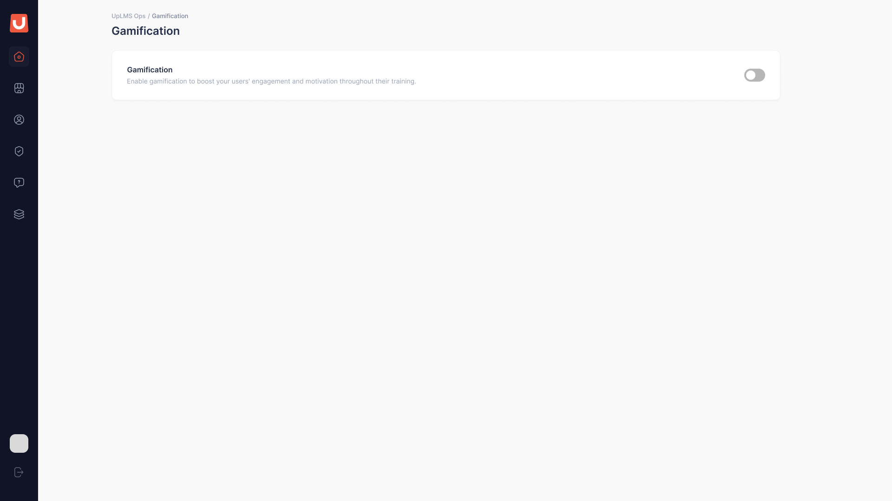
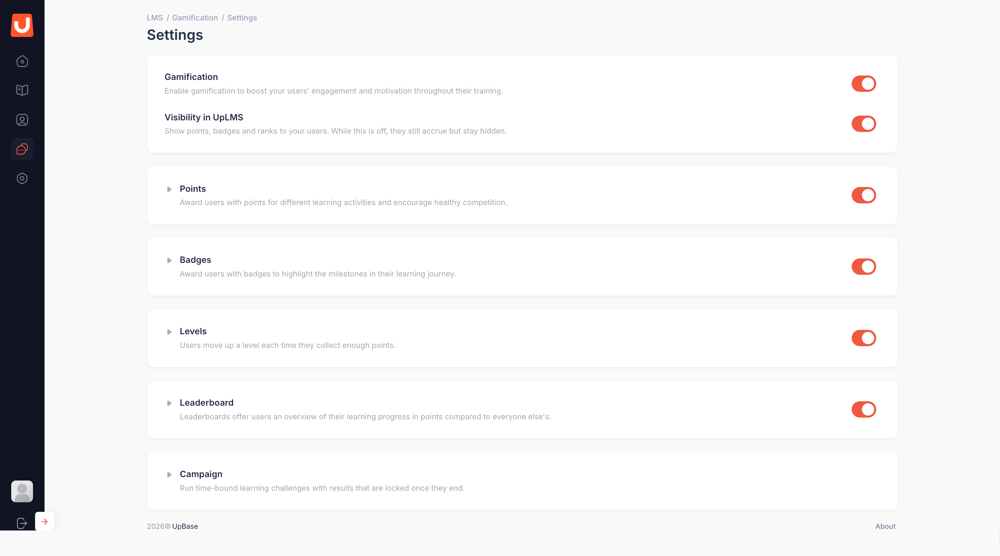
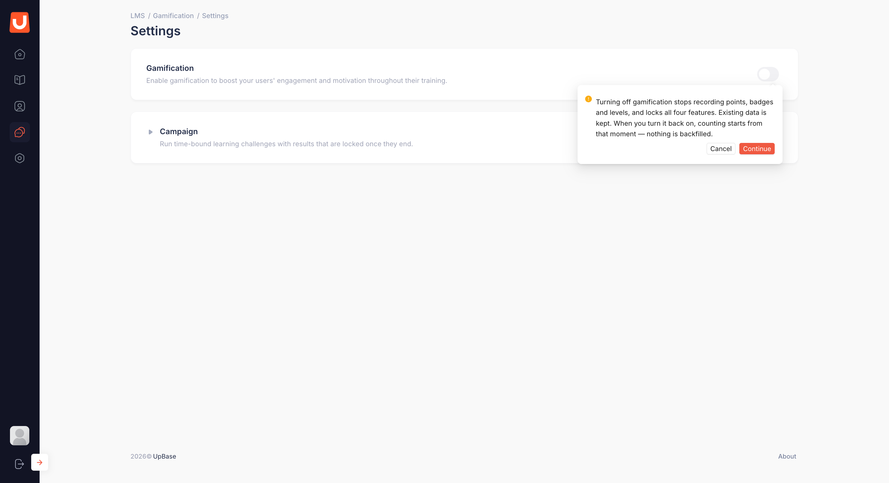
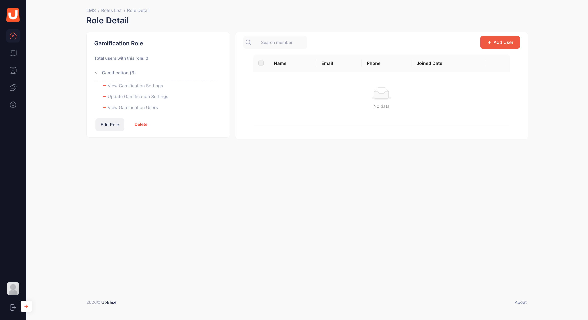

# Bật, tắt Gamification

## I. Thông tin chung


**Dành cho:** UpLMS Operator

**Đường dẫn:** Gamification



#### Phạm vi & Module liên quan

* **Module chính:** Gamification
* **Module liên quan:** Phân quyền Ops, UpLMS (phía học viên)



#### Điều kiện tiên quyết

* Đã có tài khoản và được cấp quyền truy cập hệ thống UpLMS Ops.
* Tài khoản có quyền **Sửa cấu hình gamification** để bật hoặc tắt tính năng. Tài khoản chỉ có quyền **Xem cấu hình gamification** có thể xem trang nhưng không thể thay đổi cấu hình.


Gamification ghi nhận việc học của học viên thành điểm, huy hiệu, hạng và bảng xếp hạng. Toàn bộ cấu hình nằm trên một trang, gồm hai công tắc chung ở đầu trang, bốn khối chức năng **Points**, **Badges**, **Levels**, **Leaderboard** và khối **Campaign** ở cuối trang.

## II. Hướng dẫn chi tiết

Hai công tắc và ba trạng thái



**Mở trang cấu hình**

Chọn **Gamification** trên thanh điều hướng bên trái của UpLMS Ops.

<figure><figcaption>
Khi Gamification đang tắt, trang chỉ còn một công tắc
</figcaption></figure>




**Bật Gamification**

Bật công tắc **Gamification**. Hệ thống bắt đầu ghi nhận theo cấu hình của từng khối chức năng: cộng điểm, trao huy hiệu, xét hạng và tính bảng xếp hạng. Công tắc **Visibility in UpLMS** và năm khối chức năng hiện ra bên dưới, bao gồm **Points**, **Badges**, **Levels**, **Leaderboard** và **Campaign**.

<figure><figcaption></figcaption></figure>



**Bật hiển thị cho học viên**

Bật công tắc **Visibility in UpLMS** để học viên nhìn thấy điểm, huy hiệu, hạng và bảng xếp hạng trên UpLMS.

Khi bật công tắc này lần đầu, hệ thống hiển thị hộp xác nhận cạnh công tắc. Sau khi xác nhận, học viên có thể xem các thành tích đã tích lũy trước đó. Hệ thống **không gửi thông báo** cho những thành tích đã có.



Hai công tắc tạo ra ba trạng thái:

| Trạng thái | **Gamification** | **Visibility in UpLMS** | Hệ thống làm gì |
| --- | --- | --- | --- |
| Tắt hẳn | Tắt | (không hiện) | Không ghi nhận, học viên không thấy Gamification |
| Chạy ngầm | Bật | Tắt | Ghi nhận thành tích theo cấu hình, học viên chưa thấy Gamification và không nhận thông báo |
| Bật đầy đủ | Bật | Bật | Ghi nhận và hiển thị cho học viên |

Chạy ngầm trước khi ra mắt

Nên chạy ngầm 2 đến 4 tuần trước khi mở cho học viên:

1. Bật **Gamification**, để **Visibility in UpLMS** tắt.
2. Cấu hình bốn khối chức năng, xem [Cấu hình Gamification](cau-hinh-gamification.md).
3. Theo dõi điểm thật của học viên ở danh sách học viên và nhật ký ghi nhận, xem [Tra cứu học viên và nhật ký](tra-cuu-hoc-vien-va-nhat-ky.md).
4. Chỉnh số điểm và mức lên hạng cho phù hợp với nhịp học thực tế.
5. Bật **Visibility in UpLMS** để ra mắt.


Đổi cấu hình trong lúc chạy ngầm cũng chỉ áp dụng cho các lần ghi nhận sau đó. Điểm đã ghi theo cấu hình cũ giữ nguyên.


Tắt Gamification

Tắt công tắc **Gamification**, hệ thống hiện hộp xác nhận cạnh công tắc. Chọn xác nhận để tắt, chọn huỷ thì công tắc giữ nguyên.

<figure></figure>

Khi tắt:

* Hệ thống ngừng ghi nhận thành tích. Học viên không thấy Gamification trên UpLMS.
* Bốn khối chức năng khoá lại, giữ nguyên giá trị đã cấu hình.
* Dữ liệu đã có giữ nguyên. Danh sách học viên, nhật ký ghi nhận và kết quả campaign vẫn xem được.
* Campaign đang chạy không ghi nhận thành tích trong thời gian tắt.

Khi bật lại, hệ thống tiếp tục ghi nhận từ thời điểm bật. Khoảng thời gian tắt **không được ghi nhận bù**; chuỗi ngày truy cập của học viên bắt đầu lại từ đầu.

Phân quyền

Quản trị gán quyền tại màn phân quyền hiện có của Ops, trong nhóm quyền **Gamification**.

<figure><figcaption></figcaption></figure>

| Màn hoặc thao tác | Xem cấu hình gamification | Sửa cấu hình gamification | Xem danh sách học viên và hạng |
| --- | --- | --- | --- |
| Xem trang cấu hình | Có | Có | Không |
| Sửa cấu hình, bật tắt | Không | Có | Không |
| Xem danh sách campaign | Có | Có | Có |
| Tạo, sửa, xoá campaign | Không | Có | Không |
| Xem và xuất kết quả campaign | Không | Không | Có |
| Xem và xuất danh sách học viên | Không | Không | Có |
| Xem nhật ký ghi nhận | Không | Không | Có |

Một vai trò có thể được gán nhiều quyền. Không có quyền nào trong ba quyền trên thì vai trò đó không thấy mục **Gamification** trên menu Ops.

## III. Lưu ý & Quy tắc nghiệp vụ


### Lưu ý quan trọng

1. Trang cấu hình **tự lưu, không có nút Save**. Ô nhập số lưu khi rời ô hoặc bấm Enter, công tắc lưu ngay khi bấm. Lưu xong có báo nhỏ **Saved**.
2. Mọi thay đổi có hiệu lực ngay và chỉ áp dụng từ thời điểm lưu trở đi. Điểm, huy hiệu, hạng học viên đã nhận không bị tính lại hay lấy lại.
3. Chỉ hai thao tác cần xác nhận: tắt **Gamification** và bật **Visibility in UpLMS** lần đầu. Các công tắc khác lưu ngay khi bấm, không hỏi lại.
4. Ngày và chuỗi ngày vào học tính theo múi giờ của tổ chức (UTC+7).
5. Tài khoản kiểm thử (**Test Account**) không phát sinh dữ liệu gamification và không xuất hiện trên bảng xếp hạng.


## IV. Các lỗi thường gặp & Hướng dẫn xử lý

| Lỗi / Tình huống | Nguyên nhân | Cách xử lý |
| --- | --- | --- |
| Không thấy mục **Gamification** trên menu | Tài khoản chưa được gán quyền nào trong nhóm Gamification | Liên hệ quản trị để được gán quyền |
| Thấy trang cấu hình nhưng không bấm được công tắc | Tài khoản chỉ có quyền **Xem cấu hình gamification** | Liên hệ quản trị nếu cần quyền sửa |
| Không thấy công tắc **Visibility in UpLMS** | **Gamification** đang tắt | Bật **Gamification** trước |
| Học viên báo không thấy Gamification | **Visibility in UpLMS** đang tắt, hoặc tài khoản là tài khoản kiểm thử | Kiểm tra công tắc và trường **Test Account** của học viên |
| Học viên hỏi vì sao không có điểm trong những ngày Gamification tắt | Thời gian tắt không được ghi nhận và không tính bù | Đây là quy tắc của hệ thống. Tránh tắt **Gamification** khi không cần thiết |
