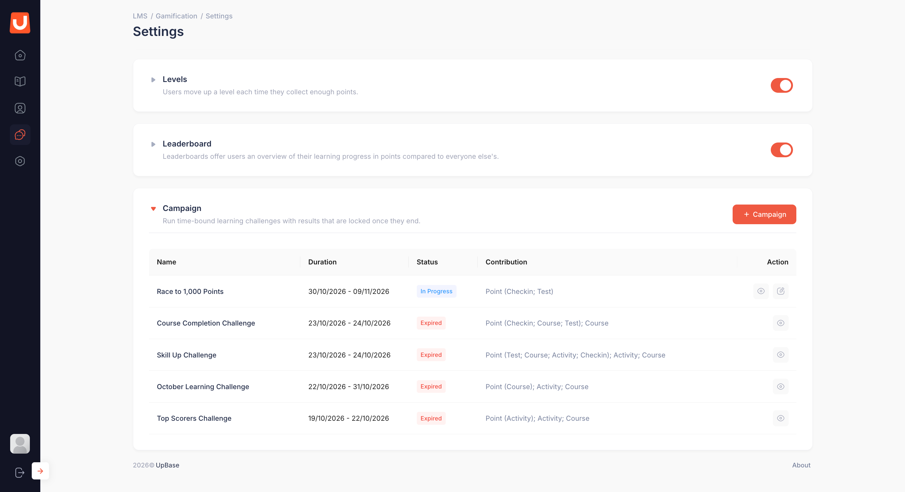
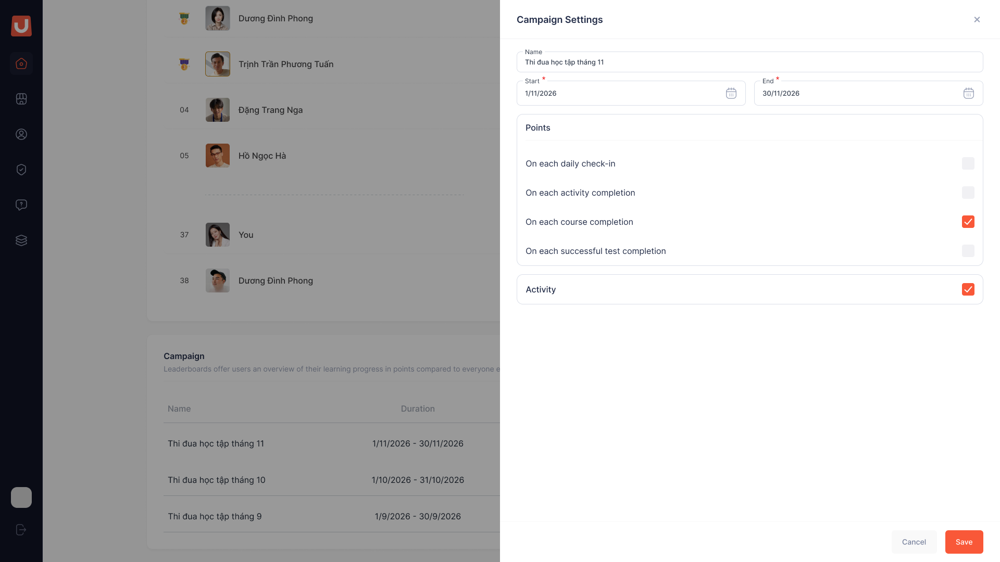
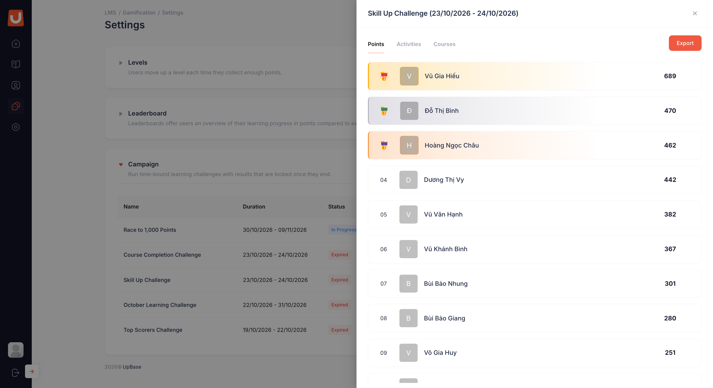

# Đợt thi đua (Campaign)

## I. Thông tin chung


**Dành cho:** UpLMS Operator

**Đường dẫn:** Gamification → khối **Campaign** (cuối trang)



#### Phạm vi & Module liên quan

* **Module chính:** Gamification (Campaign)
* **Module liên quan:** Leaderboard, Points



#### Điều kiện tiên quyết

* Tạo, sửa, xoá campaign: tài khoản có quyền **Sửa cấu hình gamification** và công tắc **Gamification** đang bật.
* Xem và xuất kết quả: tài khoản có quyền **Xem danh sách học viên và hạng**.
* Học viên chỉ thấy campaign khi khối **Leaderboard** đang bật.


Campaign là đợt thi đua có thời hạn trên toàn tổ chức, ví dụ "Thi đua học tập tháng 11". Bảng xếp hạng chung là số liệu sống, tiếp tục được cập nhật, còn kết quả campaign được chốt khi kết thúc để làm căn cứ công bố và trao thưởng.

## II. Hướng dẫn chi tiết

Danh sách campaign

<figure><figcaption></figcaption></figure>

Khối **Campaign** liệt kê mọi campaign của tổ chức với các cột:

* **Name**: tên campaign.
* **Duration**: ngày bắt đầu và ngày kết thúc.
* **Status**: **Not started** (chưa bắt đầu), **In Progress** (đang chạy) hoặc **Expired** (đã kết thúc). Trạng thái tính theo ngày hiện tại.
* **Contribution**: các chỉ số và hành động được tính trong campaign, ví dụ `Point (Checkin; Activity); Activity; Course`.
* **Action**: các thao tác khả dụng theo trạng thái campaign và quyền của tài khoản.

Tạo campaign



**Mở biểu mẫu tạo campaign**

Chọn **+ Campaign** để mở bảng thiết lập **Campaign Settings** bên phải màn hình.

<figure><figcaption></figcaption></figure>




**Nhập thông tin**

* **Name:** tên campaign, bắt buộc.
* **Start:** ngày bắt đầu, bắt buộc, sớm nhất là ngày mai.
* **End:** ngày kết thúc, bắt buộc, không trước ngày bắt đầu. Bắt đầu và kết thúc cùng một ngày là hợp lệ.



**Chọn hành động được tính điểm**

“Trong nhóm **Points**, chọn ít nhất một hành động được tính điểm cho campaign.

* **On each daily check-in**
* **On each activity completion**
* **On each course completion**
* **On each successful test completion**
* **On each badge earned**

Campaign sử dụng mức điểm thưởng của từng hành động tại khối **Points**, không thiết lập mức điểm thưởng riêng.

Hành động đang tắt ở khối **Points** vẫn chọn được, nhưng chưa sinh điểm cho tới khi được bật lại.



**Chọn bảng Activities**

“Chọn ô **Activity** nếu muốn bổ sung bảng xếp hạng theo số hoạt động hoàn thành. Bảng **Courses** (số khoá hoàn thành) luôn được hiển thị.



**Lưu campaign**

Bấm **Save** để tạo, **Cancel** để huỷ. Khác trang cấu hình, form này không tự lưu.



Sửa và xoá campaign

| Trạng thái | Sửa | Xoá |
| --- | --- | --- |
| **Not started** | Sửa được mọi thông tin | Được. Xác nhận bằng hộp xác nhận cạnh nút xoá |
| **In Progress** | Chỉ sửa được tên | Không được. Cũng không dừng sớm được |
| **Expired** | Chỉ xem | Không được |

Campaign đang chạy giữ nguyên luật tới khi kết thúc để học viên đang thi đua không bị đổi luật giữa chừng.


Trạng thái được xét lúc bấm **Save**. Ví dụ mở form lúc 23:50 khi campaign còn **Not started** rồi bấm **Save** lúc 00:05 hôm sau, khi campaign đã chạy: chỉ thay đổi tên được lưu, các thay đổi khác bị từ chối kèm thông báo lý do.


Xem và xuất kết quả



**Mở kết quả**

Tại cột **Action**, chọn biểu tượng xem để mở kết quả của campaign đang diễn ra hoặc đã kết thúc. Panel kết quả mở ra từ cạnh phải, tiêu đề là tên campaign kèm khoảng thời gian.

<figure><figcaption></figcaption></figure>




**Xem từng bảng**

Chọn tab **Points**, **Activities** (nếu campaign có) hoặc **Courses**. Ba học viên dẫn đầu được làm nổi bật, chọn **Show All** để xem toàn bộ học viên.

* Campaign đang chạy: kết quả tạm thời, kèm nhãn **Last updated**. Bảng tính lại khoảng 8 tiếng một lần.
* Campaign đã kết thúc: kết quả chính thức, kèm thời điểm chốt.



**Xuất Excel**

Bấm nút **Export** để tải file Excel gồm mọi bảng của campaign. Campaign đang chạy vẫn xuất được, file ghi rõ đây là kết quả tạm thời.



## III. Lưu ý & Quy tắc nghiệp vụ


### Lưu ý quan trọng

1. Kết quả chốt đúng lúc campaign kết thúc và **không bao giờ thay đổi**. Dùng file xuất từ campaign đã kết thúc để công bố và trao thưởng.
2. Không dùng danh sách học viên để thay kết quả campaign. Danh sách học viên là số liệu sống và không lọc theo loại hành động, nên số liệu có thể khác với kết quả campaign học viên đã thấy.
3. Bài Test nộp trong campaign nhưng được chấm đạt sau khi campaign kết thúc thì không tính.
4. Học viên bị **Block** hoặc rời tổ chức trước khi campaign kết thúc sẽ không xuất hiện trong kết quả. Nếu thay đổi trạng thái sau khi kết thúc, kết quả đã chốt vẫn được giữ nguyên.
5. Nhiều campaign được chạy chồng thời gian. Mỗi campaign tính độc lập.
6. Đổi cấu hình khối **Points** trong lúc campaign đang chạy là đổi luật của campaign đó. Cân nhắc trước khi sửa.
7. Hệ thống không gửi thông báo cho học viên khi campaign bắt đầu hay kết thúc. Đội truyền thông tự thông báo qua kênh của tổ chức.


## IV. Các lỗi thường gặp & Hướng dẫn xử lý

| Lỗi / Tình huống | Nguyên nhân | Cách xử lý |
| --- | --- | --- |
| Không thấy nút **+ Campaign** | Tài khoản không có quyền **Sửa cấu hình gamification**, hoặc **Gamification** đang tắt | Kiểm tra quyền và công tắc **Gamification** |
| Không chọn được ngày bắt đầu là hôm nay | Ngày bắt đầu sớm nhất là ngày mai | Chọn từ ngày mai trở đi |
| Không sửa được ngày hoặc hành động | Campaign đã bắt đầu | Chỉ sửa được tên. Cần luật khác thì tạo campaign mới |
| Không xoá được campaign | Campaign đang chạy hoặc đã kết thúc | Không xoá được campaign ở hai trạng thái này |
| Không mở được kết quả campaign | Tài khoản không có quyền **Xem danh sách học viên và hạng** | Liên hệ quản trị để được gán quyền |
| Học viên không thấy campaign | Campaign chưa bắt đầu, hoặc khối **Leaderboard** đang tắt | Campaign hiện với học viên từ ngày bắt đầu, khi **Leaderboard** bật |
