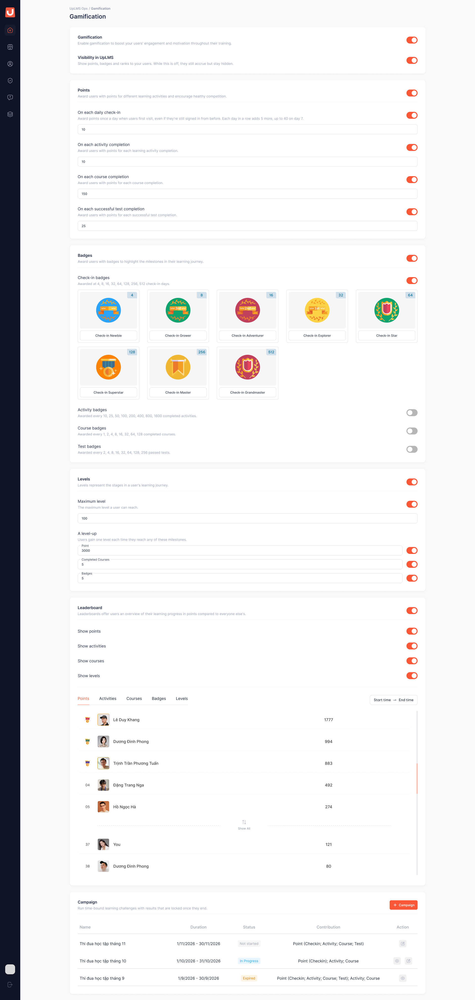

# Cấu hình Gamification

## I. Thông tin chung


**Dành cho:** UpLMS Operator

**Đường dẫn:** Gamification → khối **Points**, **Badges**, **Levels**, **Leaderboard**



#### Phạm vi & Module liên quan

* **Module chính:** Gamification
* **Module liên quan:** Course, Hoạt động học, Hoạt động kiểm tra (Test), Resources



#### Điều kiện tiên quyết

* Tài khoản có quyền **Sửa cấu hình gamification**.
* Công tắc **Gamification** đang bật, xem [Bật tắt Gamification](bat-tat-gamification.md).


Mỗi khối có công tắc riêng ở góc phải tiêu đề. Khối đang tắt thì phần tương ứng biến khỏi giao diện học viên, dữ liệu vẫn giữ nguyên và hiện lại khi bật lại.

<figure><figcaption></figcaption></figure>

## II. Hướng dẫn chi tiết

Points: điểm cho từng hành động



**Bật khối Points**

Bật công tắc **Points**. Năm hành động hiện bên dưới, mỗi hành động có công tắc riêng và một ô nhập số điểm.



**Khai số điểm cho từng hành động**

| Hành động | Ý nghĩa |
| --- | --- |
| **On each daily check-in** | Điểm cho lần đầu học viên vào UpLMS mỗi ngày. Ô nhập là **điểm nền**, tức điểm của ngày đầu tiên trong chuỗi. Mỗi ngày liên tiếp sau đó được thêm `5` điểm, tối đa `40` điểm một ngày. Điểm nền từ `40` trở lên thì ngày nào cũng nhận đúng điểm nền |
| **On each activity completion** | Điểm cho mỗi hoạt động học hoàn thành |
| **On each course completion** | Điểm cho mỗi khoá hoàn thành |
| **On each successful test completion** | Điểm cho mỗi bài Test đạt **Pass Point**. Bài trượt không có điểm |
| **On each badge earned** | Điểm cho mỗi lần học viên đạt một huy hiệu. Hành động này khoá khi khối **Badges** tắt |

Số điểm là số nguyên từ `1` trở lên, không có giới hạn trên. Muốn một hành động không sinh điểm thì tắt công tắc của hành động đó, không nhập `0`.



**Kiểm tra đã lưu**

Rời ô hoặc bấm Enter để lưu. Báo nhỏ **Saved** hiện lên là xong. Ô để trống hoặc nhập sai định dạng thì không lưu và báo lỗi ngay tại ô.




Số điểm có hiệu lực ngay khi rời ô. Gõ nhầm `1500` thay vì `150` thì học viên hoàn thành khoá ngay lúc đó nhận `1500` điểm, và điểm đã cộng không tính lại. Kiểm tra kỹ số trước khi rời ô.


Badges: huy hiệu



**Bật khối Badges và từng loại huy hiệu**

Bật công tắc **Badges**, rồi bật từng loại cần dùng. Bốn loại bật tắt độc lập:

| Loại | Đếm gì | Các mốc |
| --- | --- | --- |
| **Check-in badges** | Tổng số ngày học viên có vào hệ thống | 4 · 8 · 16 · 32 · 64 · 128 · 256 · 512 |
| **Activity badges** | Số hoạt động học hoàn thành | 10 · 25 · 50 · 100 · 200 · 400 · 800 · 1600 |
| **Test badges** | Số bài Test đạt | 2 · 4 · 8 · 16 · 32 · 64 · 128 · 256 |
| **Course badges** | Số khoá hoàn thành | 1 · 2 · 4 · 8 · 16 · 32 · 64 · 128 |



**Đặt tên, hình và mô tả cho từng mốc**

Mỗi mốc là một thẻ huy hiệu. Trên từng thẻ:

* **Tên huy hiệu:** có sẵn tên mặc định, sửa nếu muốn. Để trống thì quay về tên mặc định.
* **Hình huy hiệu:** có sẵn hình mặc định. Chọn từ kho tài nguyên hoặc tải lên ảnh mới.
* **Mô tả:** không bắt buộc. Học viên thấy mô tả khi trỏ chuột vào huy hiệu.

Tên và mô tả lưu khi rời ô, hình lưu khi tải lên xong.




* Giá trị mốc do hệ thống định sẵn, không sửa được. Không có thao tác tạo, xoá hay thêm bớt mốc.
* Đổi tên, hình hoặc mô tả áp dụng ngay cho cả huy hiệu học viên đã đạt.
* Bật **Badges** hoặc bật lại một loại thì học viên được trao ngay mọi mốc đã vượt qua của loại đó. Huy hiệu trao kiểu này không gửi thông báo và không cộng điểm **On each badge earned**.


Levels: hạng

Học viên lên hạng theo điểm tích luỹ. Mọi điểm học viên nhận được đều cộng vào **điểm trong hạng**. Đủ số điểm yêu cầu thì lên hạng, phần dư chuyển sang hạng mới.



**Bật khối Levels**

Bật công tắc **Levels**. Khối này cần khối **Points** đang bật. Khi **Points** tắt, khối **Levels** khoá lại và hiện dòng `Turn on Points to use levels. Levels are based on the points users collect.`



**Đặt số điểm cần để lên hạng**

Ba ô cùng quyết định số điểm học viên cần tích trong một hạng để lên hạng kế tiếp:

| Ô | Ý nghĩa | Ràng buộc |
| --- | --- | --- |
| **Standard level-up points** | Số điểm cho một lần lên hạng khi chưa cộng thêm gì. Lần lên hạng đầu tiên, từ hạng 1 lên hạng 2, cần đúng số này | Số nguyên từ `1` trở lên, bắt buộc |
| **Extra points per level** | Mỗi hạng sau cần nhiều hơn hạng ngay trước bao nhiêu điểm. Nhập `0` để mọi hạng cần như nhau | Số nguyên từ `0` trở lên, bắt buộc |
| **Level-up points cap** | Số điểm cần cho một lần lên hạng tăng tới mức này thì dừng. Để trống thì tăng mãi | Không nhỏ hơn **Standard level-up points**, được để trống |




**Kiểm tra bảng xem trước**

Ngay dưới ba ô là bảng xem trước, cập nhật ngay khi bạn gõ để thấy hệ quả trước khi rời ô:

* **Level:** lần lên hạng, ví dụ `1 → 2` là từ hạng 1 lên hạng 2.
* **Points needed:** số điểm cần cho lần lên hạng đó.
* **Difficulty vs level 1:** lần lên hạng này cần nhiều hơn lần đầu (`1 → 2`) bao nhiêu phần trăm. Phần trăm càng lớn thì hạng càng khó lên. Khi phần trăm thôi tăng, từ đó mỗi hạng cần cùng số điểm.

Ví dụ với `250` · `250` · `2500`:

| Level | Points needed | Difficulty vs level 1 |
| --- | --- | --- |
| 1 → 2 | 250 pts | — |
| 2 → 3 | 500 pts | +100% |
| 3 → 4 | 750 pts | +200% |
| 4 → 5 | 1,000 pts | +300% |
| 5 → 6 | 1,250 pts | +400% |
| 6 → 7 | 1,500 pts | +500% |
| 7 → 8 | 1,750 pts | +600% |
| 8 → 9 | 2,000 pts | +700% |
| 9 → 10 | 2,250 pts | +800% |
| 10 → 11 | 2,500 pts | +900% |
| 11 onwards | 2,500 pts | +900% |

Bảng hiện tối đa khoảng 10 lần lên hạng. Thang dài hơn thì được rút gọn bằng dòng `…`. Để trống **Level-up points cap** thì dòng cuối cho biết mỗi hạng sau cần thêm bao nhiêu điểm. **Extra points per level** bằng `0` thì bảng chỉ còn một dòng **Every level**.



**Đặt hạng tối đa**

Bật **Maximum level** và nhập hạng cao nhất học viên có thể đạt. Tắt **Maximum level** nếu không muốn giới hạn.

**Maximum level** khác **Level-up points cap**: **Level-up points cap** giới hạn số điểm cho một lần lên hạng, còn **Maximum level** giới hạn hạng cao nhất.



| Muốn | Chỉnh |
| --- | --- |
| Học viên mới lên hạng đầu nhanh hơn | Giảm **Standard level-up points** |
| Các hạng giữa khó lên hơn | Tăng **Extra points per level** |
| Học viên lâu năm lên hạng đều hơn | Giảm **Level-up points cap** |
| Mọi hạng cần số điểm như nhau | **Extra points per level** = `0` |


* Đổi ba ô này thì hạng và điểm trong hạng của học viên giữ nguyên. Mức mới áp dụng từ lần xét kế tiếp. Học viên có điểm trong hạng đã vượt mức mới sẽ lên hạng ở lần nhận điểm kế tiếp, có thể lên nhiều hạng một lúc.
* Hạng chỉ lên, không tụt. Hạ **Maximum level** xuống dưới hạng hiện tại của một số học viên thì họ vẫn giữ hạng đang có.
* **Level-up points cap** bằng **Standard level-up points** thì **Extra points per level** không còn tác dụng. Ô này vẫn sửa được và hiện dòng nhắc `Has no effect while the cap equals the standard level-up points.`


Leaderboard: bảng xếp hạng



**Bật khối Leaderboard**

Bật công tắc **Leaderboard**. Tắt khối này thì toàn bộ bảng xếp hạng và campaign biến khỏi UpLMS, dữ liệu vẫn được ghi bình thường.



**Chọn bảng hiện cho học viên**

Mỗi chỉ số là một bảng riêng, bật tắt bằng năm công tắc:

| Công tắc | Bảng | Ghi chú |
| --- | --- | --- |
| **Show points** | Theo điểm | Khoá khi **Points** tắt |
| **Show activities** | Theo số hoạt động hoàn thành | |
| **Show courses** | Theo số khoá hoàn thành | |
| **Show badges** | Theo số huy hiệu | Chỉ có ở **All time**. Khoá khi **Badges** tắt |
| **Show levels** | Theo hạng | Chỉ có ở **All time**. Khoá khi **Levels** tắt |

Phải còn ít nhất một bảng đang chạy. Bảng cuối cùng không tắt được.



**Xem trước bảng xếp hạng**

Cuối khối **Leaderboard** có phần xem trước gồm các tab của bảng đang bật, top 3, 5 dòng đầu và đường **Show All**.

Phần xem trước cho chọn khoảng ngày tự do (**Start time → End time**) hoặc nút nhanh **All time** · **This week** · **This month** · **This quarter** · **This year**. Học viên thì chỉ có năm khung cố định, nên khi chọn khoảng tự do, bạn đang xem một bảng học viên không thấy.




* Đổi công tắc bảng có hiệu lực ở lần học viên mở trang kế tiếp.
* Số liệu bảng xếp hạng phía học viên tính lại khoảng 8 tiếng một lần.
* Năm công tắc này chỉ áp cho bảng xếp hạng chung. Bảng của campaign do từng campaign quyết định, xem [Campaign](campaign.md).


## III. Lưu ý & Quy tắc nghiệp vụ


### Lưu ý quan trọng

1. Trang tự lưu. Mọi thay đổi có hiệu lực ngay và chỉ áp dụng từ thời điểm lưu trở đi. Không có gì bị tính lại hay lấy lại khỏi học viên.
2. Đổi cấu hình **Points** là đổi luật của mọi campaign đang chạy. Tắt một hành động thì hành động đó ngừng đóng góp cho campaign. Đổi số điểm thì campaign mang hai mức điểm trước và sau lúc đổi.
3. Tắt **Points** hoặc một hành động: số hoạt động, số khoá, số bài Test và tiến độ huy hiệu vẫn được đếm, chỉ không có điểm. Học viên không thấy những lần ghi nhận 0 điểm, vận hành vẫn thấy trong nhật ký ghi nhận.
4. Tắt **Points** thì **Levels** khoá theo: ngừng xét lên hạng, học viên giữ hạng đang có. Bật lại **Points** thì **Levels** chạy lại như trước.


## IV. Các lỗi thường gặp & Hướng dẫn xử lý

| Lỗi / Tình huống | Nguyên nhân | Cách xử lý |
| --- | --- | --- |
| Không nhập được số điểm | Hành động hoặc khối **Points** đang tắt | Bật công tắc tương ứng |
| Ô số điểm báo lỗi, không lưu | Để trống, nhập `0`, số âm hoặc số thập phân | Nhập số nguyên từ `1` trở lên |
| **On each badge earned** không thao tác được | Khối **Badges** đang tắt | Bật **Badges** |
| Khối **Levels** không thao tác được | Khối **Points** đang tắt | Bật **Points** |
| **Level-up points cap** báo `Must be at least the standard level-up points.` | Số nhập nhỏ hơn **Standard level-up points** | Nhập số lớn hơn hoặc bằng, hoặc để trống |
| Không tắt được công tắc một bảng xếp hạng | Đây là bảng đang chạy cuối cùng | Bật một bảng khác trước rồi mới tắt bảng này |
| Công tắc một bảng xếp hạng bị khoá | Chức năng sinh ra bảng đó đang tắt | Bật lại **Points**, **Badges** hoặc **Levels** tương ứng |
| Không sửa được giá trị mốc huy hiệu | Mốc do hệ thống định sẵn | Không sửa được. Chỉ đổi tên, hình và mô tả |
