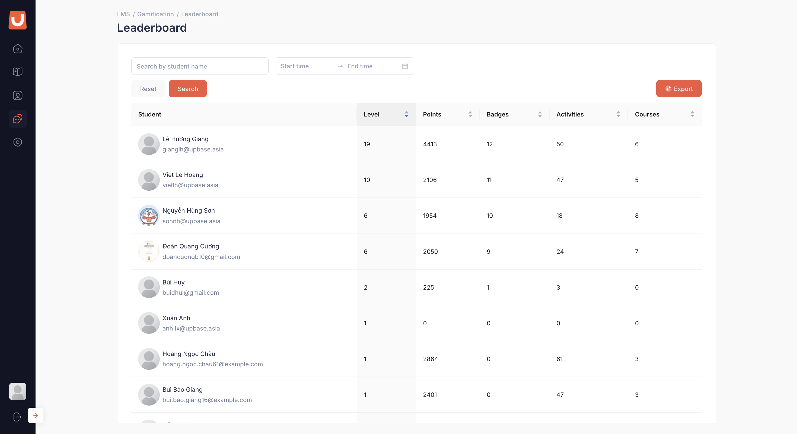
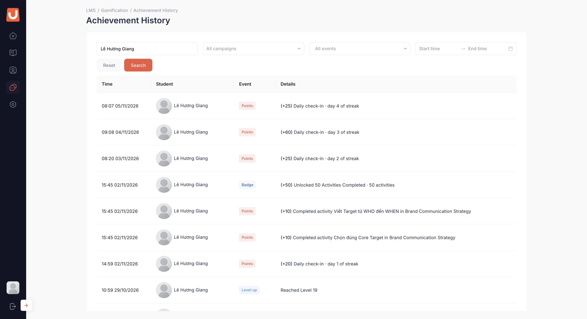
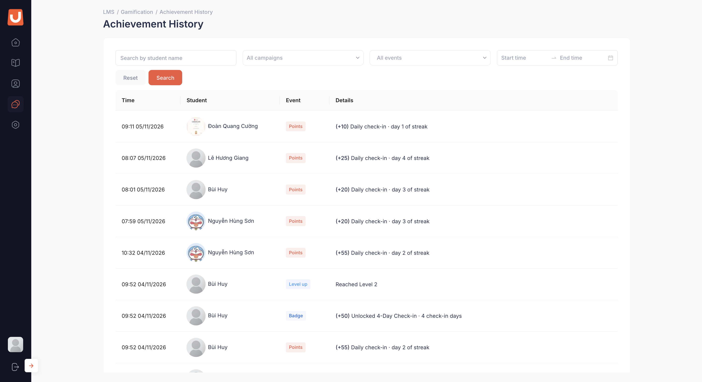

# Tra cứu học viên và nhật ký

## I. Thông tin chung


**Dành cho:** UpLMS Operator

**Đường dẫn:** Gamification → **Leaderboard**, Gamification → **Achievement history**



#### Phạm vi & Module liên quan

* **Module chính:** Gamification
* **Module liên quan:** User Management (Students)



#### Điều kiện tiên quyết

* Tài khoản có quyền **Xem danh sách học viên và hạng**.
* Bạn vẫn có thể tra cứu dữ liệu đã ghi nhận khi **Gamification** đang tắt.


Hai màn hình chỉ hỗ trợ tra cứu. Operator không thể trực tiếp cộng hoặc trừ điểm, sửa hạng, trao hoặc thu hồi huy hiệu.

## II. Hướng dẫn chi tiết

Danh sách học viên



**Mở danh sách**
<figure><figcaption></figcaption></figure>

Trong khu vực **Gamification**, mở danh sách học viên. Danh sách bao gồm các học viên thuộc phạm vi hiển thị của tổ chức, kể cả học viên chưa tích lũy điểm.

| Cột | Ý nghĩa |
| --- | --- |
| **Student** | Ảnh đại diện và tên học viên |
| **Level** | Hạng hiện tại. Ẩn khi khối **Levels** tắt |
| **Points** | Số điểm tích lũy trong khoảng thời gian đang chọn. Cột được ẩn khi khối **Points** tắt.|
| **Badges** | Số huy hiệu đã đạt của các loại đang bật. Ẩn khi khối **Badges** tắt |
| **Activities** | Số hoạt động học đã hoàn thành |
| **Courses** | Số khoá đã hoàn thành |



**Lọc, tìm kiếm và sắp xếp**

* **Search:** tìm theo tên học viên.
* **Khoảng ngày:** chọn tự do **Start time → End time**, hoặc nút nhanh **All time** · **This week** · **This month** · **This quarter** · **This year**. Mặc định **All time**. Chọn một khoảng thì **Points**, **Activities**, **Courses** tính trong khoảng đó, còn cột **Level** và **Badges** thì chỉ hiển thị tổng số đã đạt từ trước đến nay (All Time).
* **Sắp xếp:** chọn tiêu đề cột để thay đổi thứ tự sắp xếp. Mặc định, danh sách được sắp xếp theo hạng giảm dần.



**Xuất Excel**

Chọn **Export** để tải file Excel chứa toàn bộ học viên khớp với bộ lọc, theo thứ tự sắp xếp hiện tại, bao gồm cả các trang chưa hiển thị.


File Excel phản ánh dữ liệu tại thời điểm xuất. Cùng một khoảng thời gian có thể cho kết quả khác ở những lần xuất sau do dữ liệu tiếp tục được cập nhật. Lưu lại file đã sử dụng để công bố hoặc đối chiếu.




**Xem nhật ký của một học viên**
<figure><figcaption></figcaption></figure>

Chọn tên học viên để mở nhật ký ghi nhận với bộ lọc học viên đã được áp dụng sẵn.



Nhật ký ghi nhận (Achievement history)

Nhật ký ghi nhận các sự kiện nhận điểm, đạt huy hiệu và lên hạng trong toàn tổ chức. Operator có thể sử dụng nhật ký để kiểm tra việc ghi nhận thành tích, kể cả trong giai đoạn chạy ngầm.



**Mở nhật ký**

Trong khu vực **Gamification**, chọn **Achievement history**.

<figure><figcaption></figcaption></figure>

| Cột | Ý nghĩa |
| --- | --- |
| **Time** | Thời điểm ghi nhận, dạng `HH:mm dd/mm/yyyy` |
| **Learner** | Ảnh đại diện và tên học viên |
| **Event** | **Points**, **Badge** hoặc **Level up** |
| **Details** | Chi tiết sự kiện và hoạt động liên quan, ví dụ `Completed activity {tên hoạt động} in {tên khoá}`, `Daily check-in · day 3 of streak`, `Reached Level 4` |
| **Points** | Số điểm của sự kiện **Points**. Để trống với **Badge** và **Level up** |

Dòng mới nhất ở trên cùng.



**Lọc nhật ký**

* **Học viên:** tìm theo tên để chỉ xem lịch sử của một người.
* **Loại sự kiện:** chọn một hoặc nhiều trong **Points**, **Badge**, **Level up**. Với **Points** có thể lọc thêm theo hành động: check-in, hoạt động, khoá, bài Test.
* **Khoảng ngày:** chọn tự do hoặc nút nhanh như danh sách học viên.



**Trả lời thắc mắc của học viên**

Ví dụ, để kiểm tra số điểm học viên nhận trong tuần, lọc theo tên và **This week**, sau đó đối chiếu các bản ghi với hoạt động học tập tương ứng.

Bản ghi có hậu tố **· points off** và giá trị Points = `0` cho biết khối **Points** hoặc hành động tương ứng đang tắt tại thời điểm ghi nhận. Những bản ghi này chỉ hiển thị cho Operator.



## III. Lưu ý & Quy tắc nghiệp vụ


### Lưu ý quan trọng

1. Danh sách học viên và nhật ký được cập nhật **ngay**. Bảng xếp hạng phía học viên cập nhật theo chu kỳ khoảng 8 giờ, nên số liệu có thể khác nhau trước lần cập nhật tiếp theo.
2. Nhật ký hiện đầy đủ kể cả khi **Visibility in UpLMS** đang tắt.
3. Nhật ký lưu toàn bộ bản ghi và không hỗ trợ chỉnh sửa, xóa hoặc xuất file. Để xuất dữ liệu, sử dụng danh sách học viên hoặc kết quả campaign; khi công bố kết quả campaign, dùng kết quả đã chốt của campaign đó.
4. Học viên bị **Block** hoặc đã rời tổ chức không có trong danh sách học viên, nhưng các dòng đã ghi của họ vẫn còn trong nhật ký.
5. Tài khoản kiểm thử (**Test Account**) không có trong cả hai màn.


## IV. Các lỗi thường gặp & Hướng dẫn xử lý

| Lỗi / Tình huống | Nguyên nhân | Cách xử lý |
| --- | --- | --- |
| Không mở được hai màn này | Tài khoản không có quyền **Xem danh sách học viên và hạng** | Liên hệ quản trị để được gán quyền |
| Không thấy cột **Level** hoặc **Badges** | Đang chọn khoảng ngày khác **All time**, hoặc khối tương ứng đang tắt | Chọn **All time** và kiểm tra công tắc khối |
| Điểm trong danh sách khác điểm trên bảng xếp hạng | Bảng xếp hạng chưa tới lượt tính lại | Chờ lượt tính kế tiếp, xem nhãn **Last updated** trên bảng xếp hạng |
| Không tìm thấy một học viên | Học viên bị **Block**, đã rời tổ chức, hoặc là tài khoản kiểm thử | Kiểm tra trạng thái tài khoản ở **User Management → Students** |
| Học viên học mà không có dòng điểm nào | Nội dung đã hoàn thành trước khi bật Gamification, hoặc đã được tính trong lượt học này | Mỗi nội dung chỉ được điểm một lần trong một lượt học |
